

  
  
  
  
  
  

# Hallo, ich bin Ailin 👋

Ich bin Mitgründerin von [WorKraken](https://workraken.com), einer Plattform, die komplexe Verwaltungsaufgaben in einfache Werkzeuge für kleine Unternehmen verwandelt.

Ich arbeite an der Schnittstelle von Produkt, Strategie und Technologie: Ich leite die Markenkommunikation und das Wachstum, beteilige mich an Produktentscheidungen und wirke aktiv an Backend-Entwicklung, Weboberflächen, Automatisierungen und Integrationen mit.

## Technologie-Stack

## Projekte

<!-- PROJECT-GRID:START -->

<picture>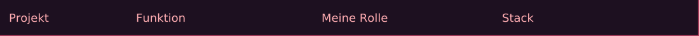</picture> 
<a href="https://github.com/Soy-Red/WorKraken" title="WorKraken">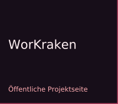</a><a href="https://workraken.com" title="Parkplatz-, Zahlungs- und Ausgabenverwaltung. Immobilien und Fuhrpark in Vorbereitung.">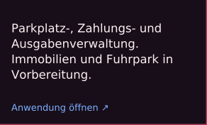</a><picture>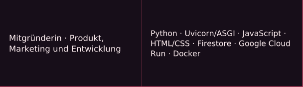</picture> 
<a href="https://github.com/Rey-de-Amarillo/ROBOILAI" title="ROBOILAI">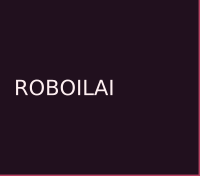</a><a href="https://roboilai.web.app/" title="Sechs Roboterentwürfe: Bauteil-CAD, Elektronik, Firmware und vertonte 3D-Demos.">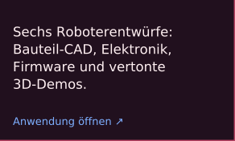</a><picture>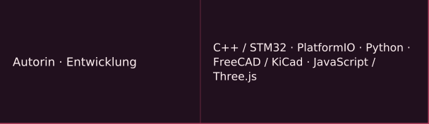</picture> 
<a href="https://workraken-marketing-1060781860075.southamerica-west1.run.app/" title="Inhaltsplanung und Prüfung von Beiträgen für soziale Medien.">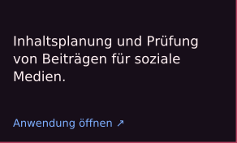</a><picture>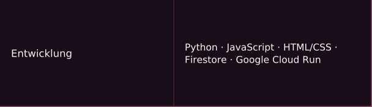</picture> 
<a href="https://github.com/Soy-Red/grabador-de-pantalla-para-linux" title="Grabador de pantalla de Linux">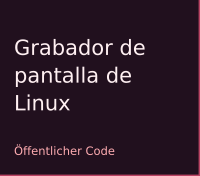</a><a href="https://github.com/Soy-Red/grabador-de-pantalla-para-linux" title="Bildschirm-, Systemton- und Mikrofonaufnahme unter Linux.">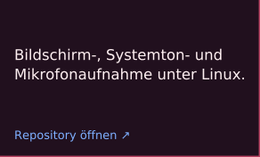</a><picture>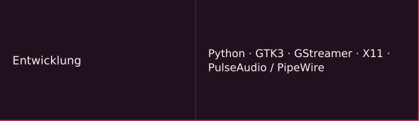</picture> 
<a href="https://github.com/Soy-Red/Carcosa" title="Carcosa">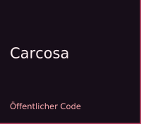</a><a href="https://github.com/Soy-Red/Carcosa" title="Kraken Edge: Labor für Sportquoten, Auszahlungen und Formeln.">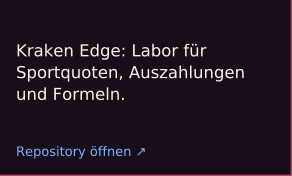</a><picture>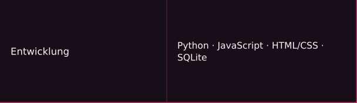</picture> 
<a href="https://github.com/Soy-Red/Postwik" title="Postwik">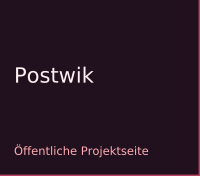</a><a href="https://github.com/Soy-Red/Postwik" title="Lokale App zum Planen, Erstellen und Prüfen von Facebook- und Instagram-Inhalten.">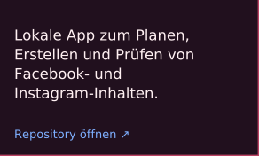</a><picture>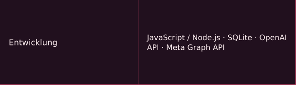</picture>

<!-- PROJECT-GRID:END -->

## Website

