

  
  
  
  
  
  

# Hi, I'm Ailin 👋

I am the co-founder of [WorKraken](https://workraken.com), a platform that turns complex management tasks into simple tools for small businesses.

I work at the intersection of product, strategy and technology: I lead the brand's communication and growth, take part in product decisions, and actively contribute to backend development, web interfaces, automations and integrations.

## Technology stack

## Projects

<!-- PROJECT-GRID:START -->

<picture>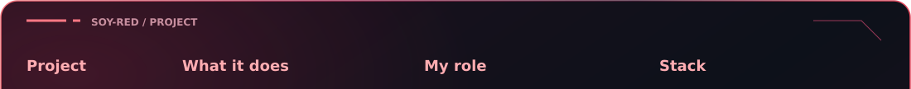</picture> 
<a href="https://github.com/Workraken" title="WorKraken">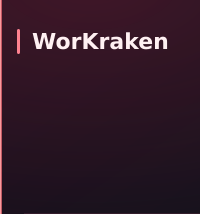</a><a href="https://workraken.com" title="https://workraken.com">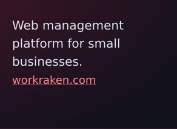</a><picture>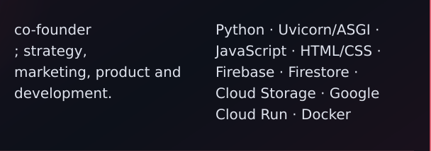</picture> 
<a href="https://github.com/Soy-Red/Marketing" title="WorKraken Marketing">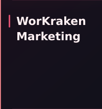</a><a href="https://workraken-marketing-1060781860075.southamerica-west1.run.app/" title="https://workraken-marketing-1060781860075.southamerica-west1.run.app/">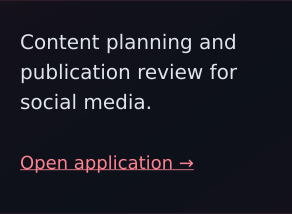</a><picture>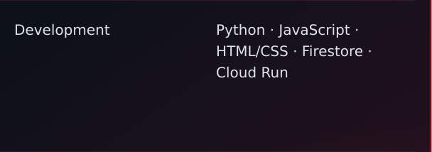</picture> 
<a href="https://github.com/Soy-Red/grabador-de-pantalla-para-linux" title="Grabador de pantalla de Linux">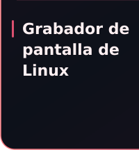</a><a href="https://github.com/Soy-Red/grabador-de-pantalla-para-linux" title="https://github.com/Soy-Red/grabador-de-pantalla-para-linux">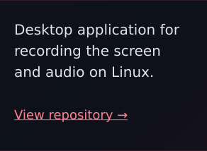</a><picture>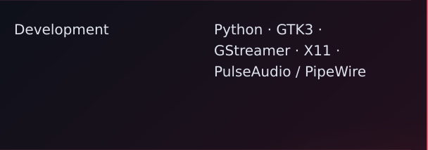</picture> 
<a href="https://github.com/Soy-Red/Carcosa" title="Carcosa">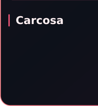</a><a href="https://github.com/Soy-Red/Carcosa" title="https://github.com/Soy-Red/Carcosa">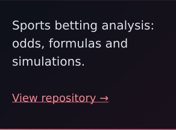</a><picture>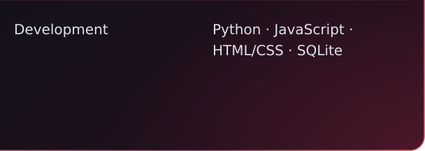</picture>

<!-- PROJECT-GRID:END -->

## Website

