

  
  
  
  
  
  

# Hi, I'm Ailin 👋

I am the co-founder of [WorKraken](https://workraken.com), a platform that turns complex management tasks into simple tools for small businesses.

I work at the intersection of product, strategy and technology: I lead the brand's communication and growth, take part in product decisions, and actively contribute to backend development, web interfaces, automations and integrations.

## Technology stack

## Projects

<!-- PROJECT-GRID:START -->

<picture>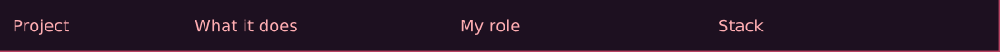</picture> 
<a href="https://github.com/Soy-Red/WorKraken-showcase" title="WorKraken">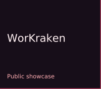</a><a href="https://workraken.com" title="Parking, payments and expense management. Property and fleet modules in preparation.">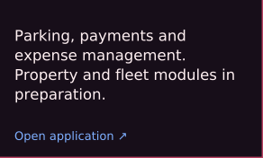</a><picture>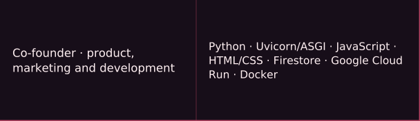</picture> 
<a href="https://github.com/Soy-Red/ROBOILAI-showcase" title="ROBOILAI">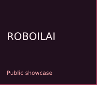</a><a href="https://roboilai.web.app/" title="Six robot designs with part-level CAD, electronics, firmware and narrated 3D demos.">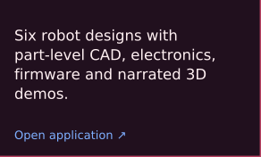</a><picture>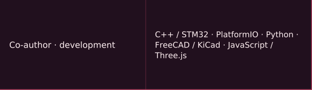</picture> 
<picture>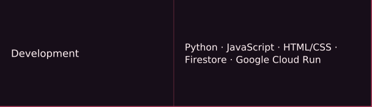</picture> 
<a href="https://github.com/Soy-Red/grabador-de-pantalla-para-linux" title="Grabador de pantalla de Linux">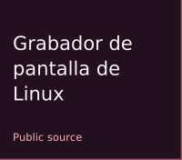</a><a href="https://github.com/Soy-Red/grabador-de-pantalla-para-linux" title="Screen, system audio and microphone recording on Linux.">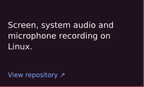</a><picture>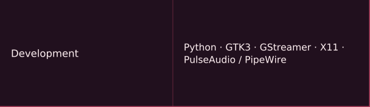</picture> 
<a href="https://github.com/Soy-Red/Carcosa" title="Carcosa">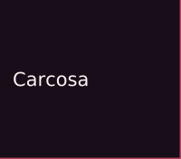</a><a href="https://github.com/Soy-Red/Carcosa" title="Kraken Edge: a lab for sports odds, payouts and formulas.">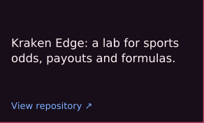</a><picture>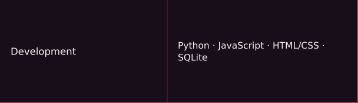</picture> 
<a href="https://github.com/Soy-Red/Postwik-showcase" title="Postwik">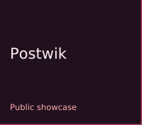</a><a href="https://github.com/Soy-Red/Postwik-showcase" title="Local app to plan, generate and review Facebook and Instagram content.">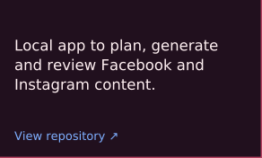</a><picture>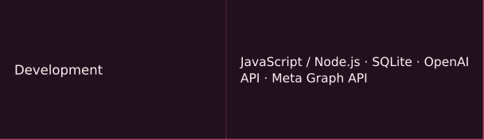</picture>

<!-- PROJECT-GRID:END -->

## Website

