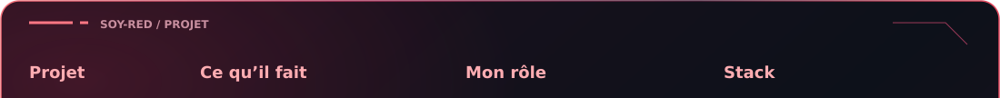
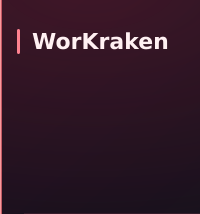
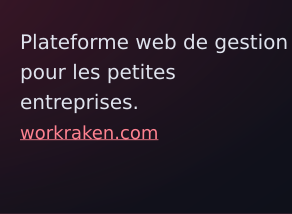
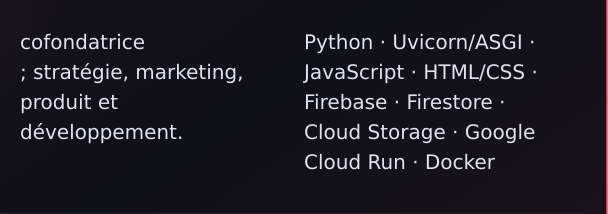
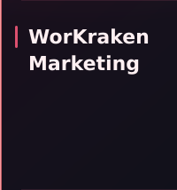
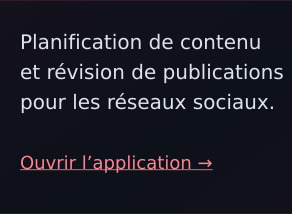
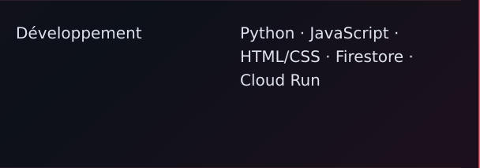
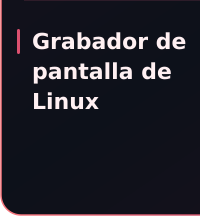
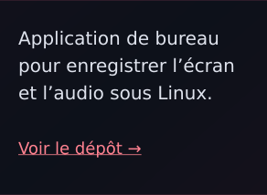
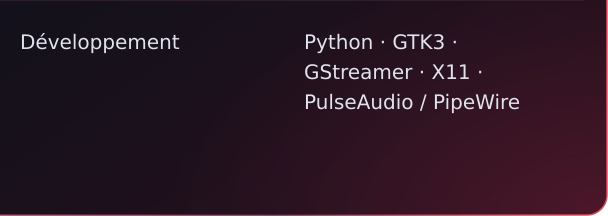

  
  
  
  
  
  

# Bonjour, je suis Ailin 👋

Je suis cofondatrice de [WorKraken](https://workraken.com), une plateforme qui transforme des tâches de gestion complexes en outils simples pour les petites entreprises.

Je travaille à la croisée du produit, de la stratégie et de la technologie : je dirige la communication et la croissance de la marque, je participe aux décisions produit et je contribue activement au développement backend, aux interfaces web, aux automatisations et aux intégrations.

## Stack technologique

## Projets

<!-- PROJECT-GRID:START -->

<picture></picture> 
<picture></picture> 
<picture></picture> 
<picture></picture>

<!-- PROJECT-GRID:END -->

## Site web

