

  
  
  
  
  
  

# Bonjour, je suis Ailin 👋

Je suis cofondatrice de [WorKraken](https://workraken.com), une plateforme qui transforme des tâches de gestion complexes en outils simples pour les petites entreprises.

Je travaille à la croisée du produit, de la stratégie et de la technologie : je dirige la communication et la croissance de la marque, je participe aux décisions produit et je contribue activement au développement backend, aux interfaces web, aux automatisations et aux intégrations.

## Stack technologique

## Projets

<!-- PROJECT-GRID:START -->

<picture>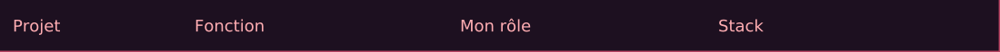</picture> 
<a href="https://github.com/Soy-Red/WorKraken-showcase" title="WorKraken">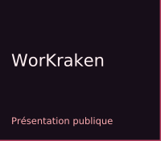</a><a href="https://workraken.com" title="Gestion de parkings, paiements et dépenses. Immobilier et flotte en préparation.">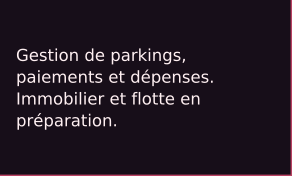</a><picture>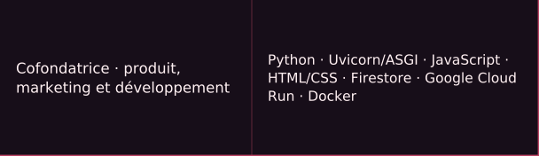</picture> 
<a href="https://github.com/Soy-Red/ROBOILAI-showcase" title="ROBOILAI">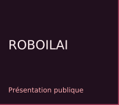</a><a href="https://roboilai.web.app/" title="Six concepts robotiques : CAO par pièce, électronique, firmware et présentations 3D.">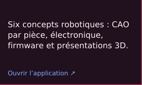</a><picture>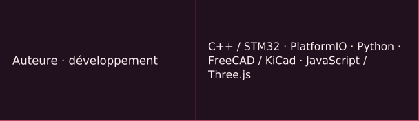</picture> 
<a href="https://workraken-marketing-1060781860075.southamerica-west1.run.app/" title="Planification de contenus et révision de publications pour les réseaux sociaux.">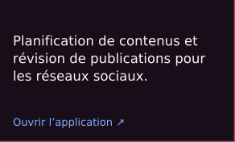</a><picture>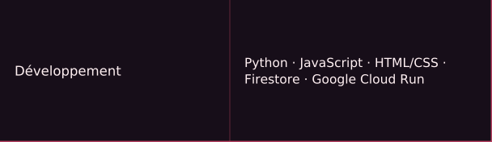</picture> 
<a href="https://github.com/Soy-Red/grabador-de-pantalla-para-linux" title="Grabador de pantalla de Linux">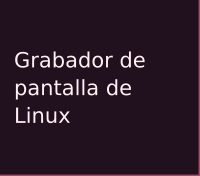</a><a href="https://github.com/Soy-Red/grabador-de-pantalla-para-linux" title="Enregistrement de l’écran, du son système et du microphone sous Linux.">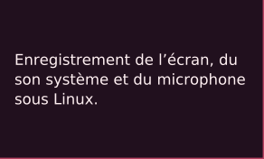</a><picture>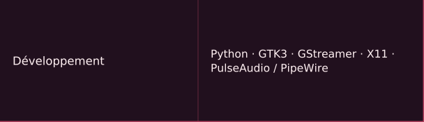</picture> 
<a href="https://github.com/Soy-Red/Carcosa" title="Carcosa">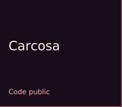</a><a href="https://github.com/Soy-Red/Carcosa" title="Kraken Edge : laboratoire de cotes, gains et formules sportives.">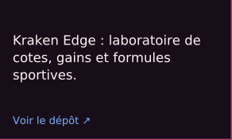</a><picture>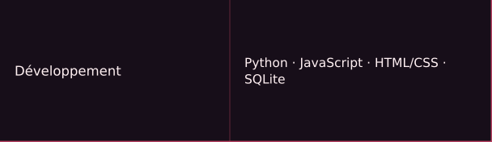</picture> 
<a href="https://github.com/Soy-Red/Postwik-showcase" title="Postwik">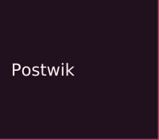</a><a href="https://github.com/Soy-Red/Postwik-showcase" title="Application locale de planification, création et révision de contenus Facebook et Instagram.">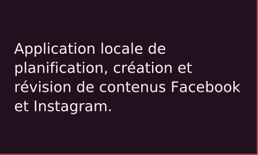</a><picture>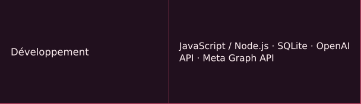</picture>

<!-- PROJECT-GRID:END -->

## Site web

