

  
  
  
  
  
  

# Ciao, sono Ailin 👋

Sono cofondatrice di [WorKraken](https://workraken.com), una piattaforma che trasforma attività di gestione complesse in strumenti semplici per le piccole imprese.

Lavoro all'incrocio tra prodotto, strategia e tecnologia: guido la comunicazione e la crescita del marchio, partecipo alle decisioni di prodotto e collaboro attivamente allo sviluppo backend, alle interfacce web, alle automazioni e alle integrazioni.

## Stack tecnologico

## Progetti

<!-- PROJECT-GRID:START -->

<picture>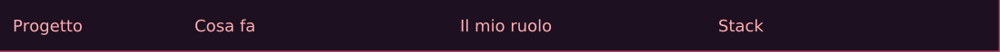</picture> 
<a href="https://github.com/Soy-Red/WorKraken-showcase" title="WorKraken">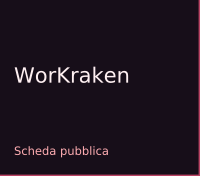</a><a href="https://workraken.com" title="Gestione di parcheggi, pagamenti e spese. Immobili e flotta in preparazione.">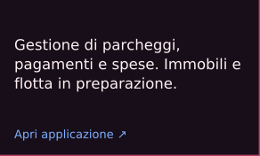</a><picture>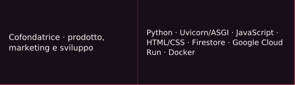</picture> 
<a href="https://github.com/Soy-Red/ROBOILAI-showcase" title="ROBOILAI">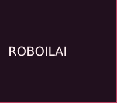</a><a href="https://roboilai.web.app/" title="Sei progetti robotici: CAD per componenti, elettronica, firmware e dimostrazioni 3D.">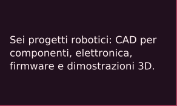</a><picture>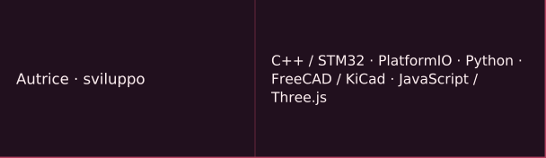</picture> 
<a href="https://github.com/Soy-Red/Marketing-showcase" title="WorKraken Marketing">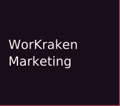</a><a href="https://workraken-marketing-1060781860075.southamerica-west1.run.app/" title="Pianificazione dei contenuti e revisione dei post per i social network.">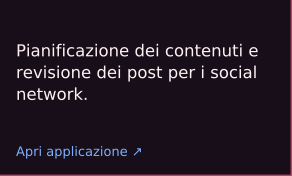</a><picture>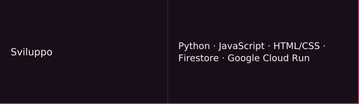</picture> 
<a href="https://github.com/Soy-Red/grabador-de-pantalla-para-linux" title="Grabador de pantalla de Linux">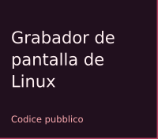</a><a href="https://github.com/Soy-Red/grabador-de-pantalla-para-linux" title="Registrazione dello schermo, audio di sistema e microfono su Linux.">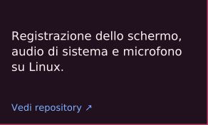</a><picture>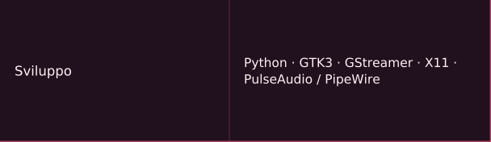</picture> 
<a href="https://github.com/Soy-Red/Carcosa" title="Carcosa">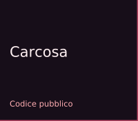</a><a href="https://github.com/Soy-Red/Carcosa" title="Kraken Edge: laboratorio di quote, pagamenti e formule sportive.">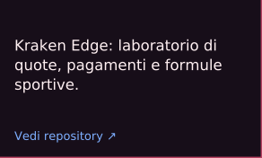</a><picture>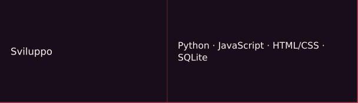</picture> 
<a href="https://github.com/Soy-Red/Postwik-showcase" title="Postwik">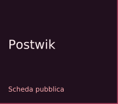</a><a href="https://github.com/Soy-Red/Postwik-showcase" title="App locale per pianificare, generare e rivedere contenuti per Facebook e Instagram.">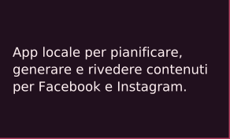</a><picture>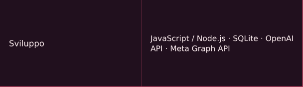</picture>

<!-- PROJECT-GRID:END -->

## Sito web

