

  
  
  
  
  
  

# Hola, soy Ailin 👋

Soy cofundadora de [WorKraken](https://workraken.com), una plataforma que transforma tareas complejas de gestión en herramientas simples para pequeños negocios.

Trabajo en la intersección entre producto, estrategia y tecnología: lidero la comunicación y el crecimiento de la marca, participo en las decisiones de producto y colaboro activamente en el desarrollo de backend, interfaces web, automatizaciones e integraciones.

## Stack tecnológico

## Proyectos

<!-- PROJECT-GRID:START -->

<picture>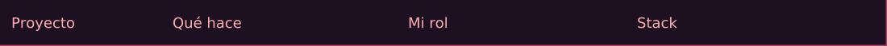</picture> 
<a href="https://github.com/Soy-Red/WorKraken-showcase" title="WorKraken">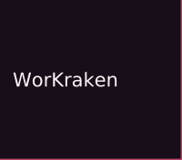</a><a href="https://workraken.com" title="Gestión de estacionamientos, cobros y gastos. Inmuebles y flota en preparación.">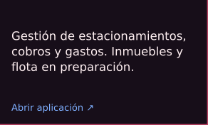</a><picture>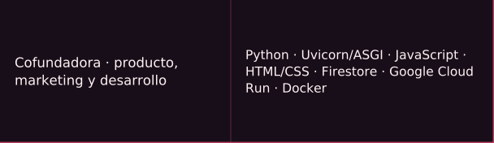</picture> 
<a href="https://roboilai.web.app/" title="Seis diseños robóticos: CAD por piezas, electrónica, firmware y presentaciones 3D.">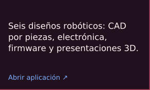</a><picture>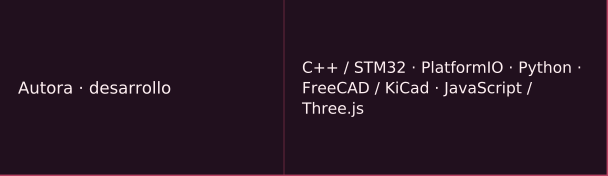</picture> 
<a href="https://workraken-marketing-1060781860075.southamerica-west1.run.app/" title="Planificación de contenido y revisión de publicaciones para redes sociales.">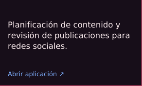</a><picture>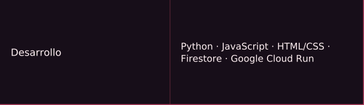</picture> 
<a href="https://github.com/Soy-Red/grabador-de-pantalla-para-linux" title="Grabador de pantalla de Linux">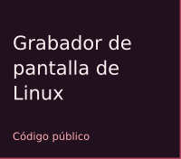</a><a href="https://github.com/Soy-Red/grabador-de-pantalla-para-linux" title="Grabación de pantalla, audio del sistema y micrófono en Linux.">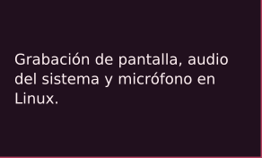</a><picture>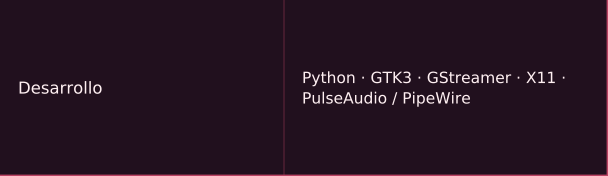</picture> 
<a href="https://github.com/Soy-Red/Carcosa" title="Carcosa">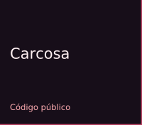</a><a href="https://github.com/Soy-Red/Carcosa" title="Kraken Edge: laboratorio de cuotas, pagos y fórmulas deportivas.">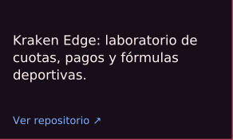</a><picture>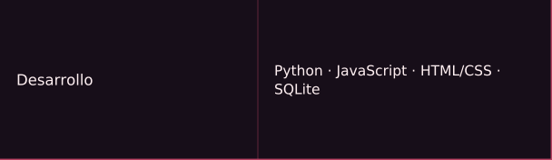</picture> 
<a href="https://github.com/Soy-Red/Postwik-showcase" title="Postwik">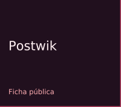</a><a href="https://github.com/Soy-Red/Postwik-showcase" title="App local para planificar, generar y revisar contenido de Facebook e Instagram.">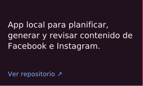</a><picture>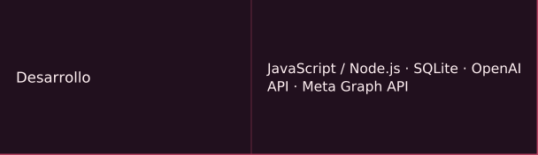</picture>

<!-- PROJECT-GRID:END -->

## Página web

