

  
  
  
  
  
  

# Hola, soy Ailin 👋

Soy cofundadora de [WorKraken](https://workraken.com), una plataforma que transforma tareas complejas de gestión en herramientas simples para pequeños negocios.

Trabajo en la intersección entre producto, estrategia y tecnología: lidero la comunicación y el crecimiento de la marca, participo en las decisiones de producto y colaboro activamente en el desarrollo de backend, interfaces web, automatizaciones e integraciones.

## Stack tecnológico

## Proyectos

<!-- PROJECT-GRID:START -->

<picture>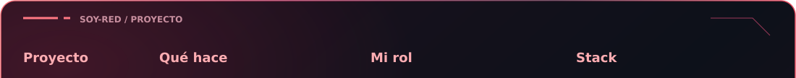</picture> 
<a href="https://github.com/Workraken" title="WorKraken">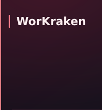</a><a href="https://workraken.com" title="https://workraken.com">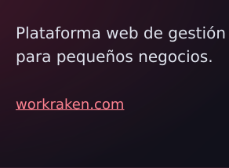</a><picture>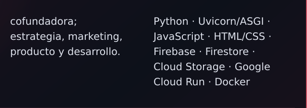</picture> 
<a href="https://github.com/Soy-Red/Marketing" title="WorKraken Marketing">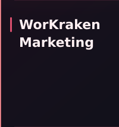</a><a href="https://workraken-marketing-1060781860075.southamerica-west1.run.app/" title="https://workraken-marketing-1060781860075.southamerica-west1.run.app/">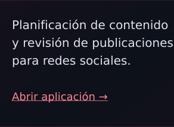</a><picture>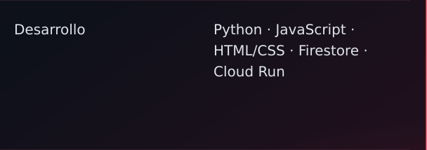</picture> 
<a href="https://github.com/Soy-Red/grabador-de-pantalla-para-linux" title="Grabador de pantalla de Linux">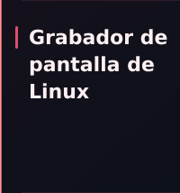</a><a href="https://github.com/Soy-Red/grabador-de-pantalla-para-linux" title="https://github.com/Soy-Red/grabador-de-pantalla-para-linux">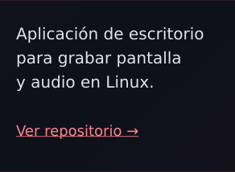</a><picture>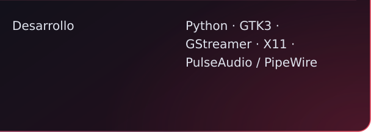</picture> 
<a href="https://github.com/Soy-Red/Carcosa" title="Carcosa">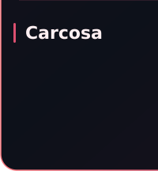</a><a href="https://github.com/Soy-Red/Carcosa" title="https://github.com/Soy-Red/Carcosa">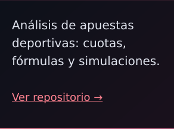</a><picture>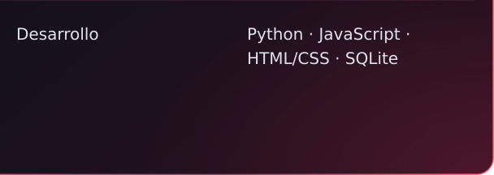</picture>

<!-- PROJECT-GRID:END -->

## Página web

