

  
  
  
  
  
  

# Olá, sou Ailin 👋

Sou cofundadora da [WorKraken](https://workraken.com), uma plataforma que transforma tarefas complexas de gestão em ferramentas simples para pequenas empresas.

Trabalho na interseção entre produto, estratégia e tecnologia: lidero a comunicação e o crescimento da marca, participo das decisões de produto e colaboro ativamente no desenvolvimento de backend, interfaces web, automações e integrações.

## Stack tecnológico

## Projetos

<!-- PROJECT-GRID:START -->

<picture>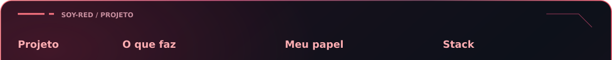</picture> 
<a href="https://github.com/Workraken" title="WorKraken">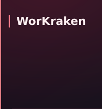</a><a href="https://workraken.com" title="https://workraken.com">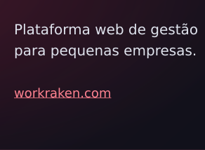</a><picture>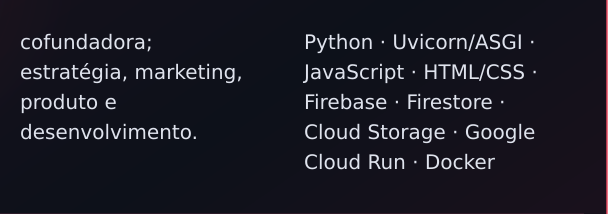</picture> 
<a href="https://github.com/Soy-Red/Marketing" title="WorKraken Marketing">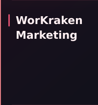</a><a href="https://workraken-marketing-1060781860075.southamerica-west1.run.app/" title="https://workraken-marketing-1060781860075.southamerica-west1.run.app/">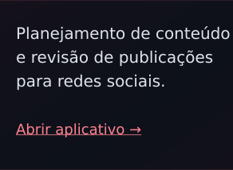</a><picture>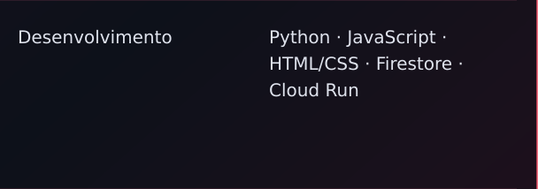</picture> 
<a href="https://github.com/Soy-Red/grabador-de-pantalla-para-linux" title="Grabador de pantalla de Linux">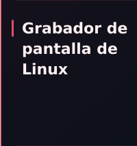</a><a href="https://github.com/Soy-Red/grabador-de-pantalla-para-linux" title="https://github.com/Soy-Red/grabador-de-pantalla-para-linux">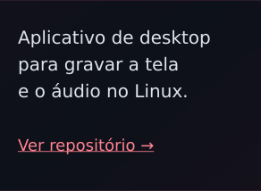</a><picture>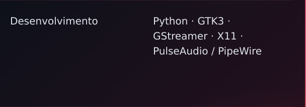</picture> 
<a href="https://github.com/Soy-Red/Carcosa" title="Carcosa">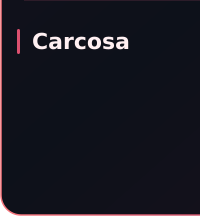</a><a href="https://github.com/Soy-Red/Carcosa" title="https://github.com/Soy-Red/Carcosa">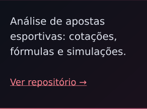</a><picture>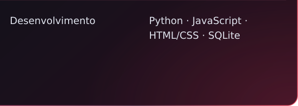</picture>

<!-- PROJECT-GRID:END -->

## Site

